# KEYBOUND — Expeditions

**A typing adventure with story missions, a space shooter, and practice that grows with you.**

Defend an orbital relay by typing enemy words, guide a ship through a storm, or climb a mountain one transmission at a time. KEYBOUND is a playable browser prototype: free to play, guest first, and built around progress saved on your device.

[Play the demo](https://keybound-expeditions.vercel.app) · [Run locally](#run-locally) · [Watch the walkthroughs](#video-walkthroughs) · [Explore the features](#features) · [Developer guide](#development)

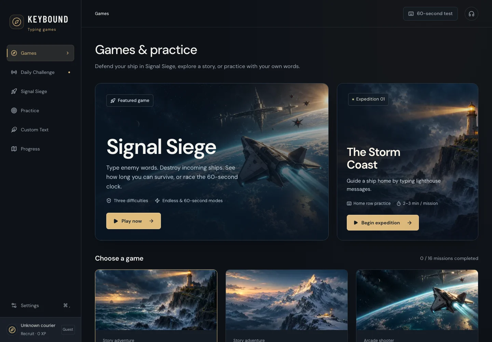

| What you can do | What is included |
| --- | --- |
| Play a typing shooter | Signal Siege / Low Orbit, Endless and 60-second arcade, three difficulties, bosses, and emergency pulses |
| Explore two stories | 16 original missions across The Storm Coast and The White Ascent |
| Build a practice routine | Daily challenges, timed word practice, a speed test, JavaScript practice, and focused key training |
| Bring your own words | Custom passages, live preview, automatic draft saving, and optional time limits |
| Make it your own | 16 free ship styles, three themes, three accents, and 11 keyboard sound packs |
| Follow your progress | WPM, accuracy, rhythm, combos, a keyboard mistake map, local XP, and shareable result cards |

## Contents

- [Run locally](#run-locally)
- [Video walkthroughs](#video-walkthroughs)
- [Features](#features)
  - [Signal Siege](#signal-siege)
  - [Ship customization](#ship-customization)
  - [Story expeditions](#story-expeditions)
  - [Daily Challenge](#daily-challenge)
  - [Practice and speed tests](#practice-and-speed-tests)
  - [Custom Text](#custom-text)
  - [Progress and sharing](#progress-and-sharing)
  - [Appearance, sound, and accessibility](#appearance-sound-and-accessibility)
- [Keyboard controls](#keyboard-controls)
- [Local data and privacy](#local-data-and-privacy)
- [Development](#development)
- [Deployment](#deployment)
- [Prototype scope](#prototype-scope)
- [Further documentation](#further-documentation)
- [Credits and assets](#credits-and-assets)

## Run locally

Requires **Node.js 24.x** and npm. The repository includes an `.nvmrc` and an npm lockfile. No environment variables, account, database, or API keys are required.

```bash
# From the project directory; skip this line if you do not use nvm.
nvm use

npm ci
npm run dev
```

Open **http://localhost:3000**, or the Local URL printed by Next.js if that port is occupied. Leave the terminal running while you play; press `Ctrl+C` to stop the server.

To choose a different port:

```bash
npm run dev -- --port 3017
```

For a first session, choose **Play now → Training → Launch defense** for the shooter, or **Begin expedition → Begin mission** for the story. **Learn to play** offers an interactive shooter tutorial.

## Video walkthroughs

These are recordings of the running application, with real typing, results, and saved progress. The clips are silent; the table describes what each walkthrough demonstrates. Click a title to open the MP4. Some repository viewers show a file page first; use **View raw** or download the file to play it.

| Walkthrough | Length | What to look for |
| --- | --- | --- |
| [Signal Siege gameplay](docs/media/signal-siege-demo.mp4) | 0:35 | Choose 60-second arcade and Training, launch through the countdown, type enemy words, deploy a pulse, pause, and save a report with cosmetic unlocks. |
| [Story expeditions](docs/media/expeditions-demo.mp4) | 1:50 | Start The Storm Coast, correct a mistake, pause and resume, complete a mission, download a result card, then enter The White Ascent. |
| [Practice tools](docs/media/practice-demo.mp4) | 1:50 | Write a custom passage and finish it, practice JavaScript with newlines and indentation, train difficult keys, and start the daily challenge. |
| [Personalization and progress](docs/media/personalization-demo.mp4) | 0:25 | Review the mistake map, switch themes and accents, find sound previews, customize a ship, test fire, and export progress. |

[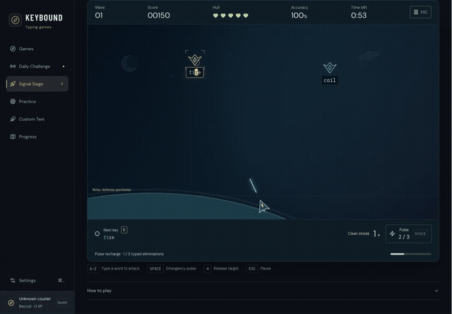](docs/media/signal-siege-demo.mp4)

See the [media guide](docs/media/README.md) for screenshot descriptions, recording notes, and instructions for updating these assets.

## Features

### Signal Siege

**Low Orbit is the arcade typing shooter.** Type the first letter of an enemy word to acquire it, then finish the word to destroy the ship. Correct letters fire visible laser bolts. Wrong letters lower accuracy and break the clean-word streak.

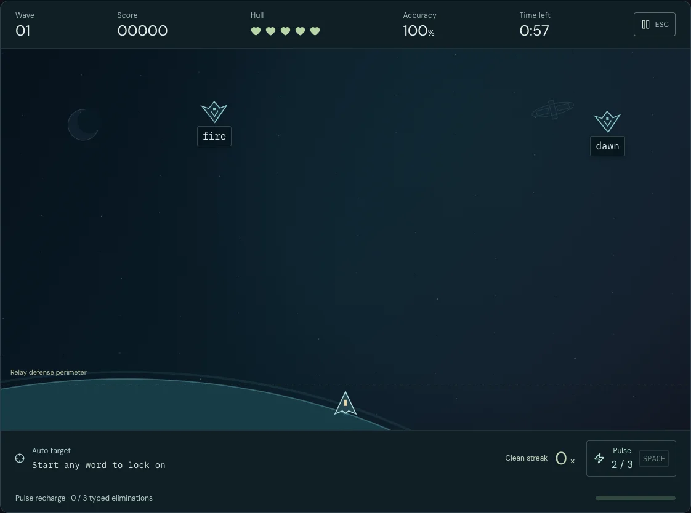

- **Two modes:** Endless lasts until you lose your hull or end the run; 60-second arcade races one minute of active play. The header's **60-second test** is a separate paragraph typing test.
- **Three difficulties:** Training gives slower enemies, shorter words, five hull shields, and faster pulse recharges. Standard has three shields and the original balance. Expert increases enemy speed and word length.
- **Waves and bosses:** Scouts, interceptors, shielded sentinels, and a dreadnought every fifth wave. Bosses have three word shields, escort launches, and an exposed-core phase.
- **Emergency pulses:** Press Space to clear regular enemies and break a protected boss shield. Typed eliminations recharge pulses; Training recharges every three kills, Standard and Expert every five.
- **Flight school:** A safe, four-step tutorial teaches target acquisition, release, word completion, and pulses without saving scores or awarding XP.
- **Pause and resume:** Escape, lost focus, or opening another page pauses the field. Returning to Signal Siege resumes the same run while the page remains open. Fullscreen includes an exit control and replay support.
- **Combat feedback:** Contact-timed explosions, ship recoil, word bursts, layered stars, target brackets, engine glow, and independent combat audio respond to your typing.
- **Results:** Separate personal records for each mode and difficulty, previous-run comparisons, missed-word review, local XP, a copyable summary, and a downloadable score card.

<details>
<summary>View mode selection and an arcade result</summary>

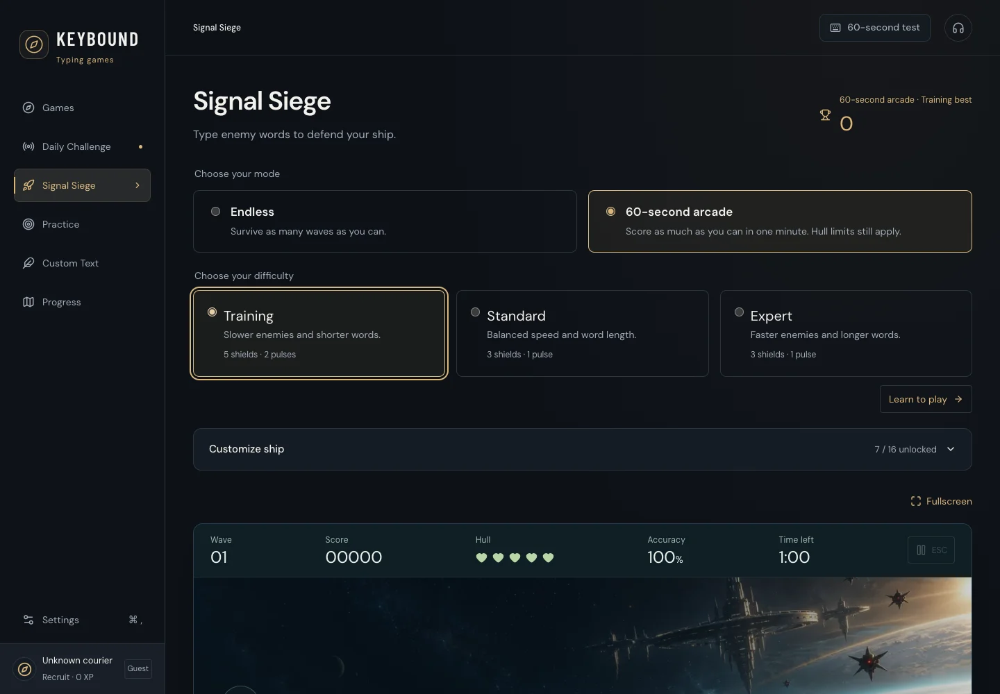

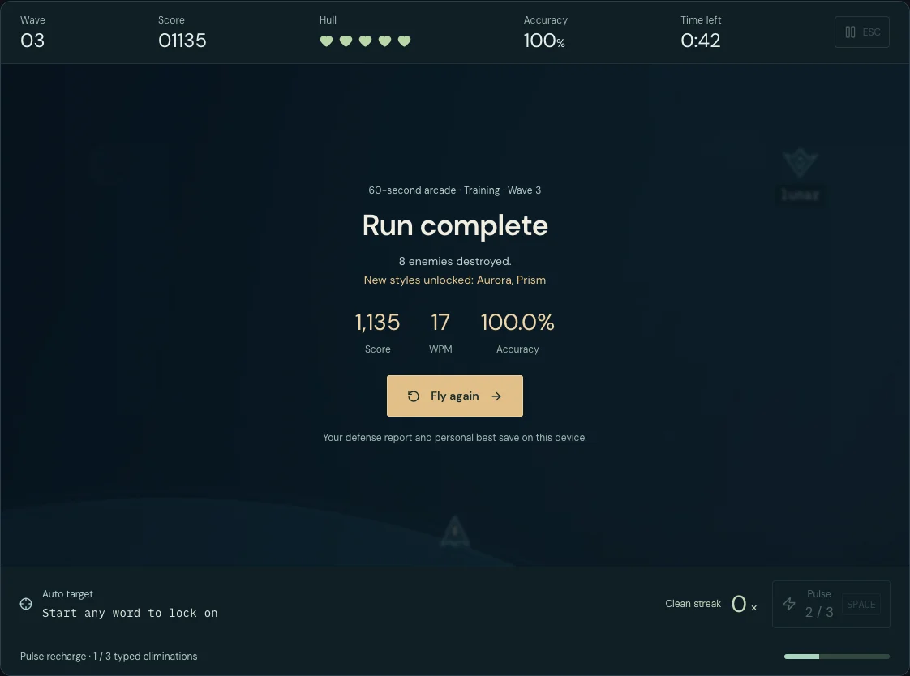

</details>

[Read the arcade guide](docs/SIGNAL-SIEGE.md).

### Ship customization

Open **Signal Siege → Customize ship** to combine **16 free choices** across five categories. Seven are available immediately; the rest unlock through recorded runs, enemy eliminations, wave progress, and clean-word streaks.

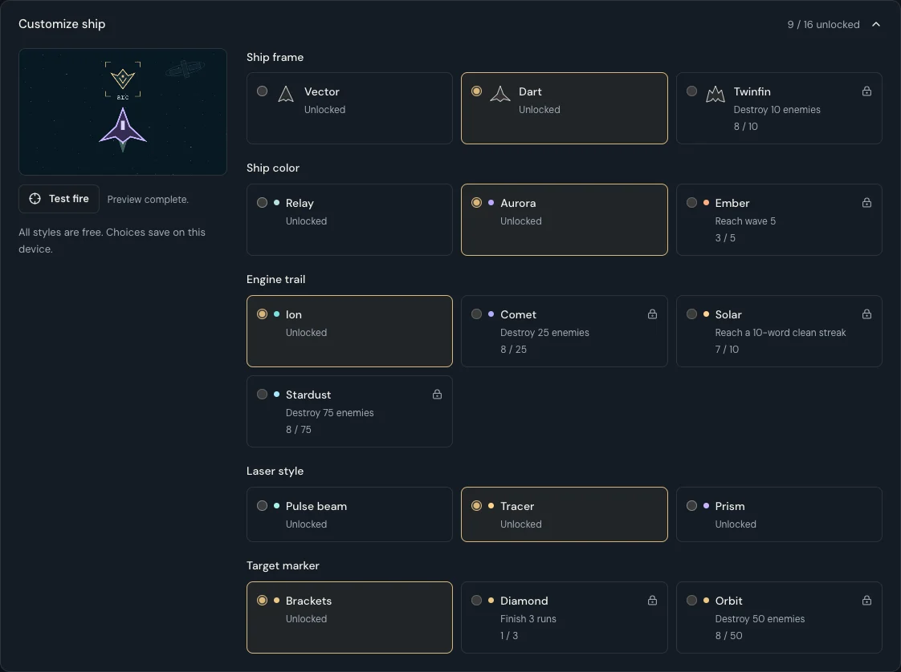

| Category | Choices |
| --- | --- |
| Ship frame | Vector, Dart, Twinfin |
| Ship color | Relay, Aurora, Ember |
| Engine trail | Ion, Comet, Solar, Stardust |
| Laser style | Pulse beam, Tracer, Prism |
| Target marker | Brackets, Diamond, Orbit |

**Test fire** previews the selected ship, recoil, lasers, and a target burst using the gameplay renderer. Cosmetics affect appearance only. Preview shots do not create scores or unlock progress. Choices and earned milestones save on this device.

### Story expeditions

Two playable chapters contain **eight original missions each**. Read Mara's briefing, type the displayed transmission exactly, and watch the scene respond to progress, clean words, and mistakes.

| The Storm Coast | The White Ascent |
| --- | --- |
| 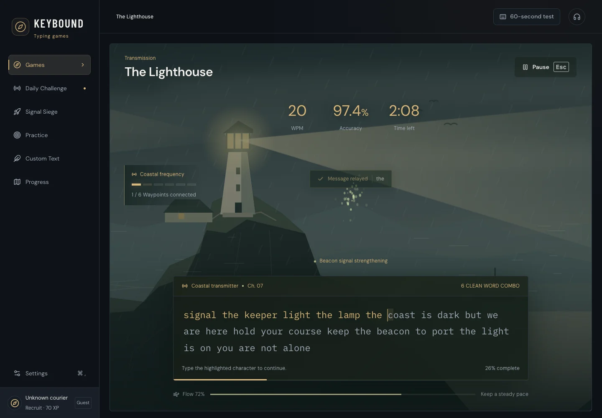 | 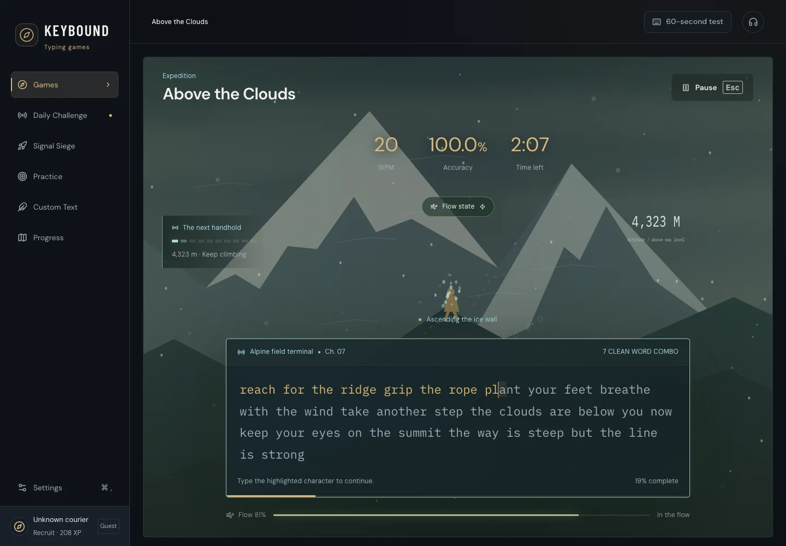 |
| Guide a ship home through lighthouse messages, a home-row drill, letters, and storm transmissions. | Climb through snow and wind, securing handholds as you complete words. |

The terminal shows useful WPM, accuracy, time, progress, and clean-word feedback. Timed sessions start their clock on the first printable keystroke. **Calm mode** removes time limits from story missions and practice. Completing a mission produces a field report and advances local mission progress.

The Abyss, The Sunken Library, and The Night City appear under **Upcoming chapters** and are marked **In development**.

### Daily Challenge

A UTC-seeded route gives everyone the same **65-word passage** for that day, with a **150-second** window. A new challenge begins at **00:00 UTC**. Retry as often as you like; your recent daily results remain local and unranked.

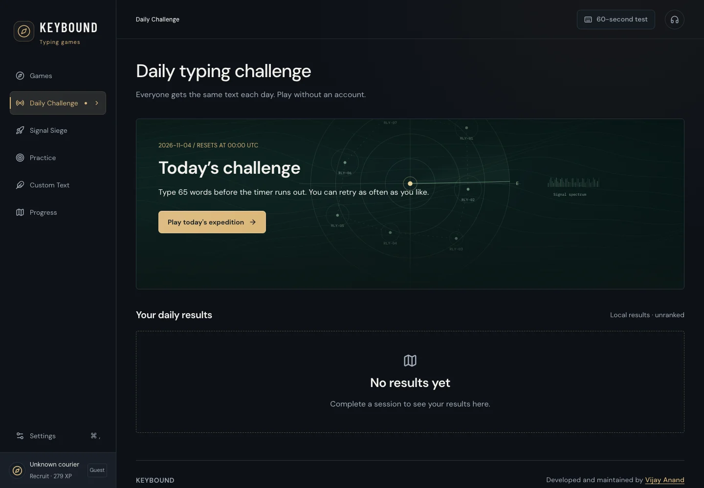

Choose **Daily Challenge → Play today's expedition → Begin mission**. The daily route uses the browser's clock; it is not a server-controlled competition.

### Practice and speed tests

Choose **Practice** for short sessions with distinct animated worlds and feedback.

| Mode | Purpose | How to start |
| --- | --- | --- |
| Field Notes | Common-word practice for 15, 30, 60, or 120 seconds | Choose a duration, then **Open field notes** |
| Weakness Hunt | Practice keys identified from saved mistakes and timing | **Train with Tick** |
| Signal Room | Type a JavaScript snippet with exact case, brackets, punctuation, newlines, and indentation | **Enter the signal room** |
| Recruitment Trial | Establish a speed and accuracy baseline in 60 seconds | **Take the trial**, or use **60-second test** in the header |

Weakness Hunt uses your recorded key history; a new player is prompted to establish a baseline. The trial records results without automatically calibrating game difficulty.

<details>
<summary>View the practice menu, JavaScript terminal, and focused key training</summary>

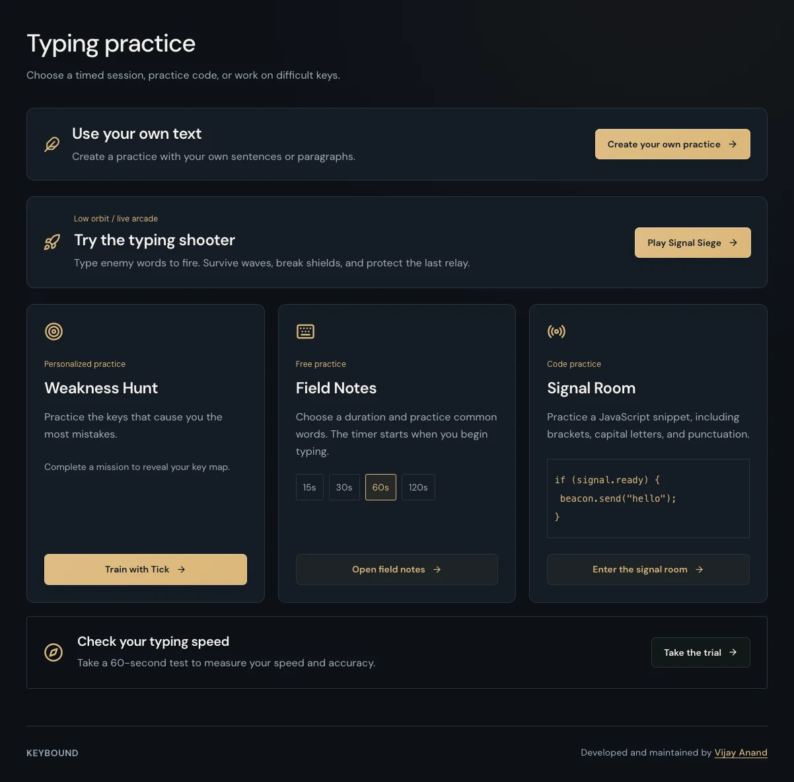

| Signal Room | Weakness Hunt |
| --- | --- |
| 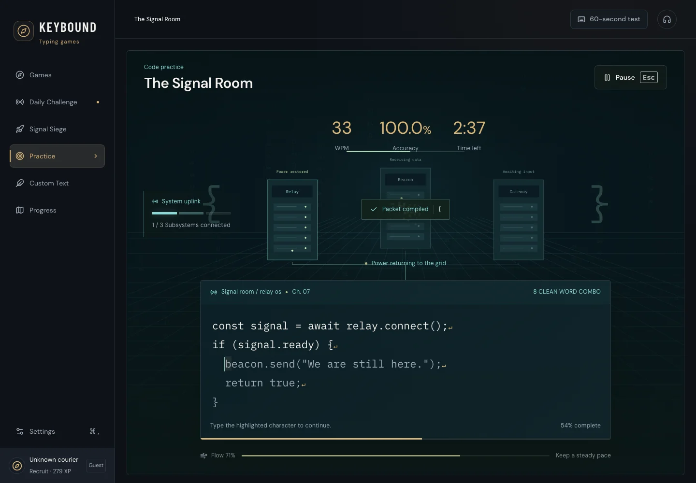 | 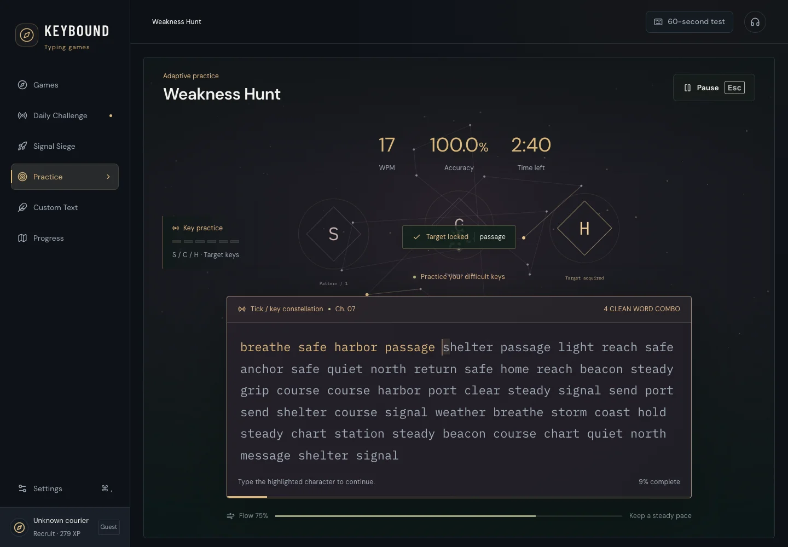 |

</details>

### Custom Text

Create a session from your own sentences, study material, or paragraphs:

1. Open **Custom Text**, add an optional title, and write or paste your passage.
2. Check the live preview and word, character, and paragraph counts.
3. Choose **Until I finish** or a 30-second, 1-minute, 2-minute, or 5-minute limit.
4. Choose **Start typing**. Your completed session appears in **Progress**.

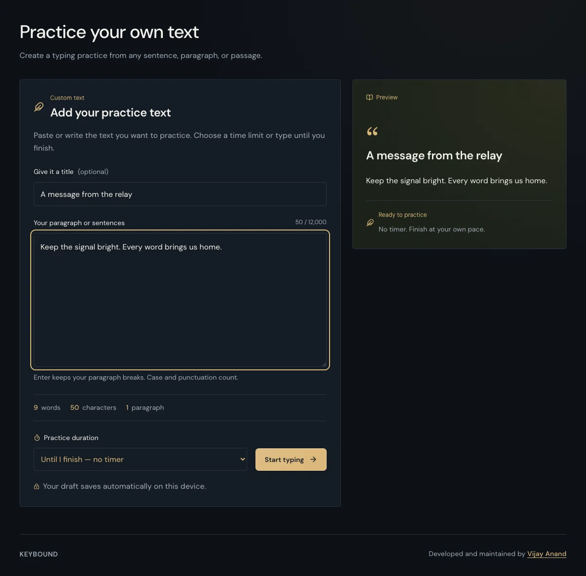

Drafts save automatically on this device. Passages support up to **12,000 characters**, multiple paragraphs, punctuation, capitalization, accented characters, and emoji-aware typing units. Case and punctuation count. Calm mode overrides the selected time limit.

[Read the custom practice guide](docs/CUSTOM-PRACTICE.md).

### Progress and sharing

**Progress** brings together completed missions, average speed and accuracy, total XP, the keyboard mistake map, and recent field reports. The keyboard map helps identify characters that need practice; Weakness Hunt uses the underlying recorded key history.

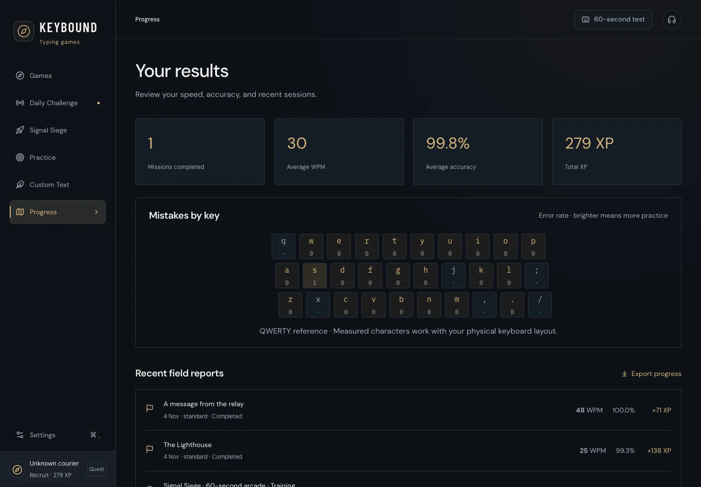

Mission reports show WPM, accuracy, duration, rhythm consistency, and the best clean-word combo. Saved metrics additionally include raw WPM and Flow. Useful WPM measures passage progress in five-character words per active minute; raw WPM counts typing attempts. Paused time is excluded. Arcade reports also show score, wave, eliminations, difficulty, and mode.

Choose **Copy results** to share a text summary or **Download card** to save a PNG. **Export progress** downloads your local journal as JSON. Export is a backup file; there is currently no import interface.

<details>
<summary>View a mission report and its downloaded score card</summary>

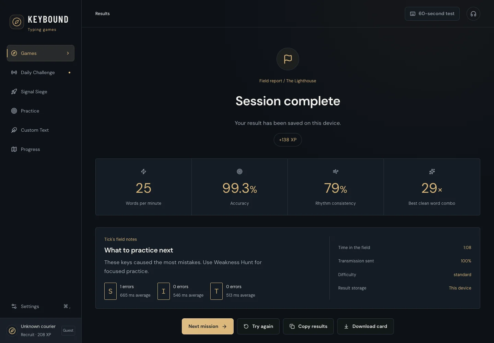

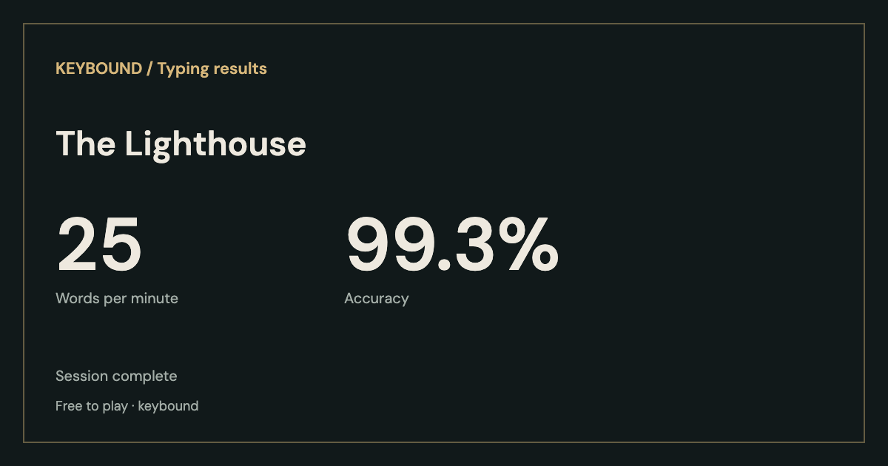

</details>

### Appearance, sound, and accessibility

Open **Settings**, or press `Cmd/Ctrl+,`, to adjust the experience.

| Setting | Available options |
| --- | --- |
| Theme | Light, Dark, or System; System follows device appearance changes |
| Accent | Amber, Sage, or Ocean |
| Keyboard audio | 11 sound packs, individual previews, and volume control |
| Combat audio | Independent effects toggle and volume, under Terminal sound |
| Calm mode | Removes time limits from story and practice; arcade keeps its own mode and difficulty |
| Motion | In-app reduced motion plus respect for the system preference |
| Readability | High contrast and larger typing text |
| Layout and navigation | Responsive desktop/mobile layouts, named controls, and keyboard-accessible menus and pause dialogs |

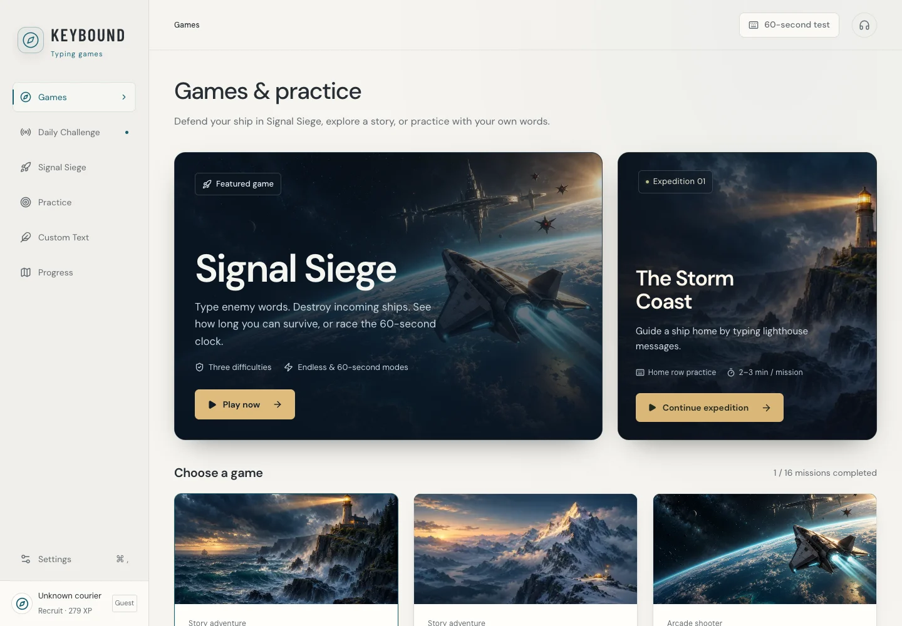

**Terminal sound is off initially.** Enable it in Settings or with the header's headphone control. The global mute covers keyboard and combat audio. Sound previews help you choose before playing.

The packs are **Soft Signal, Mechanical Click, Deep Thock, Vintage Typewriter, Brass Telegraph, Pocket Arcade**, and **MechKeys Tactile, Classic, Clicky, Linear, and Typewriter**. Tactile and Classic use bundled CC0 recordings; the other profiles synthesize audio locally through Web Audio.

Reduced motion limits decorative animation while preserving essential arcade enemy movement. Leaving the tab or window pauses active play. Keyboard layout and accessibility support have practical limits described under [Prototype scope](#prototype-scope).

<details>
<summary>View settings, sound packs, and the mobile layout</summary>

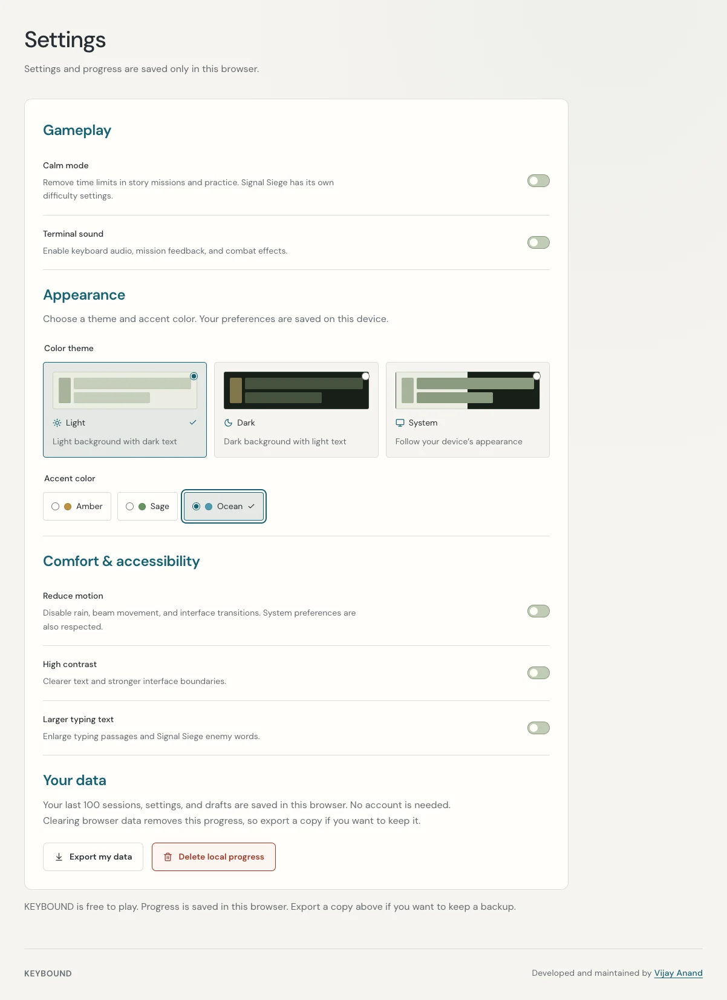

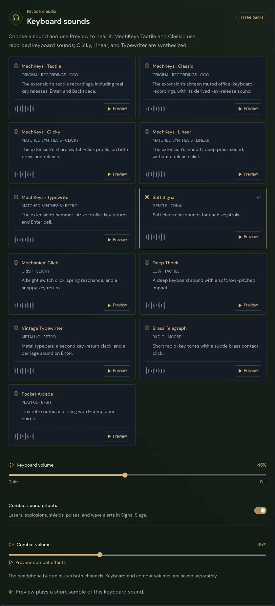

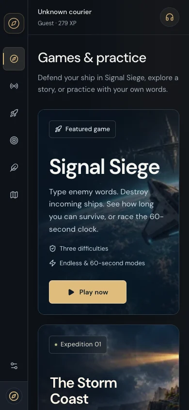

</details>

[Appearance guide](docs/APPEARANCE.md) · [Sound pack guide](docs/SOUND-PACKS.md).

## Keyboard controls

| Action | Story and practice | Signal Siege |
| --- | --- | --- |
| Type | Match the displayed passage exactly | Type an enemy word's first letter to lock on; finish it to attack |
| Backspace | Clear a current error; otherwise revisit a character | Release the current target and reset its word |
| Enter | Begin a focused mission briefing; type a newline in multiline/code passages | Follow the focused control |
| Tab | Move between controls; inserts two spaces during code/custom text play | Move between controls outside active typing |
| Space | Type a space in the passage | Spend an emergency pulse |
| Escape | Pause or resume | Pause or resume; cancel the launch countdown |
| Shift+Enter | Restart a story/practice mission | Use **Fly again** after finishing |
| Cmd/Ctrl+, | Open Settings | Open Settings and pause play |

On-screen controls also provide pause, resume, pulse, release target, and fullscreen actions where applicable. A physical keyboard is recommended for extended typing; narrow layouts also support a focused touch-keyboard input.

## Local data and privacy

KEYBOUND stores its journal in the browser's **IndexedDB** using `idb-keyval`:

- The most recent **100 sessions**, settings, and your custom draft.
- Arcade records separated by mode and difficulty.
- Cosmetic selections and durable unlock milestones, which survive the session-history cap.

There is no sign-in, cloud sync, ranked leaderboard, or server-side player database. Closing or reloading the page discards an unfinished arcade run. Clearing site data removes local progress.

Use **Settings → Export my data** for a JSON copy. **Delete local progress → Delete everything** clears the saved journal and preferences. This project does not include analytics integration; hosting providers may retain their own infrastructure logs.

## Development

The application uses **Next.js 16.4.3**, **React 19.3.1**, **TypeScript**, SVG and Canvas 2D scenes, Web Audio, and IndexedDB. Fonts, cover artwork, and keyboard recordings are served locally. The current package version is **0.17.0**.

```text
app/                    Next.js entry points, metadata, and interface styles
components/             Application shell, games, editor, reports, and settings
game/                   Typing and arcade engines, rendering, audio, saves, and preferences
content/missions.json   Original story missions and briefings
public/                 Game covers, local fonts, and keyboard recordings
tests/                  Vitest checks and Playwright browser journeys
docs/                   Feature guides, design review, validation notes, and README media
scripts/                Reproducible README media capture
.github/workflows/      Automated project checks
```

### Commands

| Command | Purpose |
| --- | --- |
| `npm run dev` | Start the development server, normally on port 3000 |
| `npm run typecheck` | Check TypeScript without emitting files |
| `npm test` | Run the Vitest suite |
| `npm run build` | Create the optimized production build |
| `npm start` | Serve an existing production build |
| `npm run test:e2e` | Run Playwright browser journeys using Google Chrome |

### Browser checks

Install Google Chrome for Playwright if it is not already installed, then run the browser suite:

```bash
npx playwright install --with-deps chrome
npm run test:e2e
```

The Playwright configuration starts a development server at **http://localhost:3017**, or reuses an existing server there. You do not need to start one manually. To test the production build with one worker:

```bash
npm run build
KEYBOUND_E2E_PRODUCTION=1 npm run test:e2e
```

Production browser checks start or reuse a server on **port 3018**. Coverage includes mission completion, corrected mistakes, pause/resume, daily routes, custom text, saved settings, arcade gameplay, timed mode, cosmetics, audio behavior, and responsive layouts. GitHub Actions runs type checking, unit tests, a production build, and browser checks.

Before changing Next.js code, read [AGENTS.md](AGENTS.md) and the relevant guide in the installed `node_modules/next/dist/docs/`; this project uses version-specific APIs and conventions.

### Updating screenshots and videos

The [capture script](scripts/capture-readme-media.mjs) uses the installed Playwright dependency and Google Chrome to play real sessions in an isolated browser profile. Install FFmpeg with H.264 encoding support and Playwright's recording helper, start the app, then run:

```bash
npx playwright install ffmpeg
node scripts/capture-readme-media.mjs
```

Use `MEDIA_BASE_URL` for a different local server or `FFMPEG_PATH` for an absolute path to a full FFmpeg binary; an explicit binary also replaces the recording helper for that capture. See the [media guide](docs/media/README.md) for the full workflow. Capturing does not modify your normal browser profile or application source.

## Deployment

The project includes `vercel.json` and can be hosted on Vercel without environment variables or a paid backend.

For a Git-based deployment, import the repository, choose **Next.js**, use **Node.js 24.x**, and select the directory containing this `package.json` as the project root. The build command is `npm run build`.

Alternatively, from an authenticated Vercel CLI:

```bash
npx vercel deploy --prod
```

To serve a production build locally:

```bash
npm run build
npm start
```

Deployment does not add account sync or shared scores; player progress remains local to each browser and origin.

## Prototype scope

This is a **playable prototype**, with these boundaries:

- **Available:** Signal Siege and 16 story missions across two chapters, daily routes, practice tools, custom passages, local progression, free cosmetics, and result sharing.
- **In development:** The Abyss, The Sunken Library, and The Night City.
- **Not implemented:** Account sync, global rankings, server anti-cheat, ghosts, multiplayer, branching mission controllers, bigram/spaced-repetition coaching, and dynamic social result images.
- Story mission types share a transmission engine. Story bosses are scripted final transmissions; the arcade dreadnought has its own multi-stage encounter.
- Daily selection trusts the browser clock. Scores and XP are local and unverified; this is not a competitive scoring service.
- The interface supports comfort settings and keyboard navigation, but has not been certified for full screen-reader gameplay, formal WCAG compliance, every physical keyboard/IME combination, or performance on every device.

See the [design review and implementation roadmap](docs/DESIGN-REVIEW.md) for the broader game concept and remaining work. Historical test results and their limits are in [validation notes](docs/VALIDATION.md).

## Further documentation

| Guide | Covers |
| --- | --- |
| [Signal Siege](docs/SIGNAL-SIEGE.md) | Difficulty profiles, tutorial, scoring, boss phases, timed mode, cosmetics, and rendering |
| [Custom practice](docs/CUSTOM-PRACTICE.md) | Editor behavior, text preparation, drafts, timers, and typing units |
| [Appearance](docs/APPEARANCE.md) | Themes, accents, saved preferences, and viewport layout |
| [Sound packs](docs/SOUND-PACKS.md) | Pack selection, previews, recordings, synthesis, and audio design |
| [Animation notes](docs/ANIMATION-UPDATE.md) | Reactive environments, feedback, pause behavior, and reduced motion |
| [Typography](docs/TYPOGRAPHY.md) | Font choices, hierarchy, and interface sizing |
| [Art direction](docs/ART-DIRECTION.md) | Cover concepts, generation prompts, and source assets |
| [Media guide](docs/media/README.md) | Screenshot inventory, video walkthroughs, and capture instructions |
| [Design review](docs/DESIGN-REVIEW.md) | Product decisions, gaps, and implementation roadmap |
| [Validation](docs/VALIDATION.md) | Historical automated checks and verification limits |

## Credits and assets

Created by **Vijay Anand**. Story text, gameplay scenes, procedural combat art, and synthesized effects were created for this project. The three cinematic game covers are AI-generated artwork; their prompts and provenance are documented in [Art direction](docs/ART-DIRECTION.md). README screenshots and videos are captures of the application itself.

The type-to-attack genre was inspired by ZType. KEYBOUND uses its own implementation, artwork, words, and progression. MechKeys Tactile and Classic recordings retain their CC0 credits. DM Sans, IBM Plex Mono, and Barlow Condensed are bundled under the SIL Open Font License; Lucide icons use the ISC license.

See [ASSETS_LICENSES.md](ASSETS_LICENSES.md) for the asset inventory, recording sources, and bundled license locations. Third-party asset licenses do not grant a blanket license to the entire repository.
